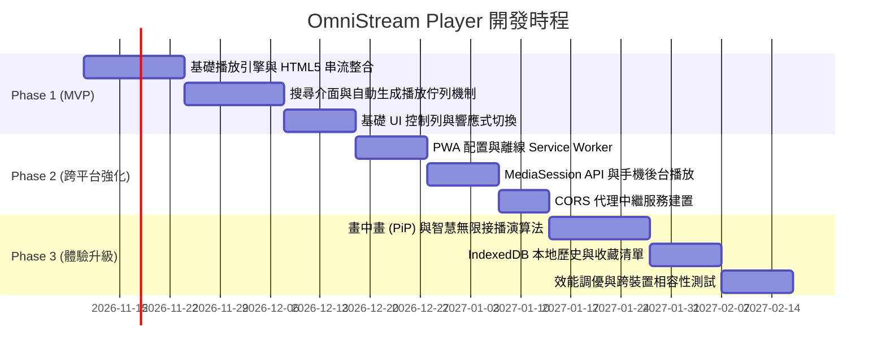

# 產品需求文檔 (PRD) - 跨平台智慧搜尋播放器 (OmniStream Player)

---

## 1. 產品概述 (Product Overview)

### 1.1 背景與問題 (Background & Problem)
目前市面上的串流與媒體播放器通常綁定特定封閉生態（如獨立 App 下載、受限於特定平台、需繁複登入註冊）。使用者若想在不同裝置（Windows、macOS、Linux、iOS、Android 等）之間即時搜尋音樂或影音並連續聆聽/觀看，常面臨：
- **切換設備成本高**：不同系統需下載安裝不同用戶端。
- **操作繁瑣**：搜尋到歌曲或影片後，通常需要手動點選「加入播放清單」才能連續播放，無法達到「搜尋結果直接化為播放佇列並即刻動播」。
- **資源受限**：App 佔用本機儲存空間，且更新需要經過應用商店審核。

### 1.2 產品願景 (Vision)
打造一款**輕量化、免安裝、透過現代 Web 技術即開即用**的跨平台多媒體播放器。使用者只要輸入關鍵字搜尋，系統即可智慧整合搜尋結果，**一鍵立即依序自動播放**，提供如串流電台般流暢無縫的跨裝置影音娛樂體驗。

### 1.3 核心價值主張 (Core Value Proposition)
- **真正的跨平台 (Zero-Install Cross-Platform)**：透過 Web + PWA (Progressive Web App) 技術，無論是桌面瀏覽器、手機、平板，甚至智慧電視瀏覽器，皆能獲得原生級 App 體驗。
- **搜尋即播放 (Search-to-Stream)**：搜尋結果自動生成「動態播放佇列 (Dynamic Queue)」，省去手動逐首加入的繁瑣動作。
- **系統層級整合 (System Media Integration)**：支援鎖定畫面封面展示、通知列控制、實體多媒體按鈕（Media Keys）操作。

---

## 2. 目標族群與使用情境 (Target Audience & User Scenarios)

### 2.1 目標族群 (Target Personas)
1. **跨裝置工作者**：上班用 Windows PC，出門用 iPhone / Android，回家用 Mac / 平板，希望在所有裝置上擁有完全一致的播放體驗與介面。
2. **背景音樂/播客愛好者**：工作、讀書或放鬆時，希望輸入一個關鍵字（如 "Lofi Hip Hop"、"Jazz"、"最新科技 Podcast"），播放器就自動連續播放相關內容，不被打斷。
3. **輕量極簡主義者**：不喜歡為了聽音樂或看影片在電腦與手機裡塞滿肥大的專用 App。

### 2.2 典型使用者旅程 (User Journey)


---

## 3. 核心功能規格 (Functional Specifications)

### 3.1 搜尋模組 (Search Engine & Source Aggregator)
- **即時/模糊搜尋**：
  - 支援輸入防抖（Debounce: 300ms）即時搜尋。
  - 支援關鍵字搜尋歷史與熱門推薦標籤（如：流行音樂、放鬆白噪音、熱門 Podcast 等）。
- **來源整合**：
  - **開源串流/公開音訊 API**（如 Jamendo、Free Music Archive、SoundCloud 公開串流、Podcast RSS Feed）。
  - **自訂媒體來源**：支援直接貼入串流網址（.mp3, .m4a, .mp4, HLS .m3u8）。
  - **本地檔案搜尋**：支援透過 Web File System API 搜尋並讀取本機音訊/影片。
- **搜尋結果篩選與排序**：
  - 類型篩選（純音訊 / 影音 / 播客）。
  - 排序維度（相關度、熱門度、長度、上傳時間）。

### 3.2 智慧動態播放佇列 (Smart Playback Queue)
- **自動播放觸發機制 (Auto-play Trigger)**：
  - 預設模式：搜尋完成後，自動將搜尋結果（前 10~20 筆）載入播放佇列，並**立即由第一筆開始自動播放**。
  - 佇列替換 vs. 佇列追加：提供「立即播放並取代現有佇列」與「加入現有佇列末端」兩種操作按鈕。
- **無縫接播 (Seamless Next Track)**：
  - 當前曲目結束前 5 秒進行下一首曲目的預載（Pre-buffering），確保曲目間切換零延遲。
  - 若搜尋結果播放至尾端，提供「智慧接播（無限模式）」：系統根據搜尋關鍵字或最後一首歌的風格自動推薦並追加歌曲，實現不斷播。
- **佇列管理**：
  - 拖曳排序（Drag & Drop reorder）。
  - 單曲移除、一鍵清空、儲存為我的播放清單。
  - 隨機播放（Shuffle）、單曲循環（Repeat One）、列表循環（Repeat All）。

### 3.3 跨平台播放器核心 (Playback Engine & Controller)
- **全格式解碼支援**：
  - 音訊：MP3, AAC, FLAC, OGG, WAV, WebM Audio。
  - 視訊：MP4, WebM, HLS (.m3u8 串流直播/點播)。
- **播放控制元件**：
  - 播放/暫停、上一首、下一首、快轉 10 秒 / 倒退 10 秒。
  - 精確進度條（Scrubber）支援時間預覽與拖拉。
  - 音量控制與靜音切換（記住上次音量設定）。
  - 播放速率調節（0.5x, 0.75x, 1.0x, 1.25x, 1.5x, 2.0x）。
- **視訊專屬功能**：
  - 畫中畫模式（Picture-in-Picture, PiP）：縮小浮動視窗，便於多工作業。
  - 純音訊模式切換（Audio-Only Mode）：在視訊內容下僅串流音軌，節省行動網路流量與電量。
  - 全螢幕切換（Fullscreen API）。

### 3.4 系統層級與硬體整合 (System Media Integration)
- **Media Session API 整合**：
  - 鎖定螢幕與通知欄顯示曲目名稱、演出者、專輯名稱與高解析度封面（Cover Art）。
  - 支援鍵盤多媒體按鍵（鍵盤上的 Play/Pause, Next, Prev, Volume）。
  - 支援耳機線控、藍牙耳機觸控手勢（播放、切換、喚醒）。
- **後台播放 (Background Playback)**：
  - 在行動端（iOS Safari / Android Chrome）切換至其他 App 或關閉螢幕時，仍可持續播放音訊。

### 3.5 響應式使用者介面 (UI / UX Design)
- **桌面寬螢幕佈局 (Desktop)**：
  - 左側導航欄（首頁、搜尋、我的收藏、歷史記錄）。
  - 中間內容區（搜尋欄、結果網格/清單、專輯封面展現）。
  - 右側邊欄（當前播放清單/佇列、動態歌詞）。
  - 底部固定式控制列（Player Bar）。
- **行動裝置佈局 (Mobile / Tablet)**：
  - 底部導航欄（搜尋、探索、收藏）。
  - 迷你播放器（Mini Player）：常駐螢幕底部，可上滑展開為全螢幕沉浸式播放介面（Full Screen Player）。
  - 手勢操作：左右滑動切換曲目、向下滑動最小化播放器。
- **外觀與主題**：
  - 預設現代深色模式（Dark Mode，減少 OLED 螢幕耗電），支援自動跟隨系統主題。
  - 音樂律動動態背景（提取專輯封面的主色系，生成柔和的毛玻璃彌散漸層效果）。

### 3.6 本地化與持久化 (Data & Storage)
- **免登入離線儲存 (IndexedDB / LocalStorage)**：
  - 自動記錄「最近播放歷史（最近 100 筆）」。
  - 「我的喜愛」與自訂歌單儲存於本機。
  - 記住播放位置（斷點續播功能）。
- **跨裝置匯出/匯入**：
  - 支援一鍵將播放清單匯出為 JSON 或 M3U 格式，並可在其他裝置上快速匯入。

---

## 4. 技術架構與選型建議 (Technical Architecture & Stack)

### 4.1 系統架構圖
```
+-------------------------------------------------------------------------+
|                              用戶端 (Client)                             |
|  [ Desktop Browsers ]      [ iOS / iPadOS Safari ]    [ Android Chrome ]|
|  (Chrome/Edge/Safari)      (PWA 主畫面捷徑)            (WebAPK 安裝)    |
+-------------------------------------------------------------------------+
                                    |
                       [ Service Worker & Cache ] (離線緩存)
                                    |
+-------------------------------------------------------------------------+
|                         前端應用層 (Next.js / Vite + React)              |
|  +--------------------+  +--------------------+  +-------------------+  |
|  |   UI / UX 佈局     |  |  狀態管理 (Zustand)|  | 播放引擎核心      |  |
|  | - 搜尋與篩選清單    |  | - 播放佇列管理     |  | - HTML5 Media API |  |
|  | - 響應式 MiniPlayer|  | - 歷史記錄持久化   |  | - MediaSession API|  |
|  | - 歌詞與封面流     |  | - 播放模式/音量狀態|  | - HLS.js 串流引擎 |  |
|  +--------------------+  +--------------------+  +-------------------+  |
+-------------------------------------------------------------------------+
                                    | HTTPS / REST / WebSocket
+-------------------------------------------------------------------------+
|                  輕量後端 / API 代理層 (BFF / Proxy)                     |
|  (Node.js Fastify / Cloudflare Workers / Go Fiber)                      |
|  - 統一搜尋 API 聚合 (聚合各音樂/音訊/影音公開端點)                      |
|  - CORS 與防盜鏈 Header 代理 (重寫 Referer/Origin)                       |
|  - 音訊中繼串流 (可選，避免瀏覽器直連跨域限制)                          |
+-------------------------------------------------------------------------+
```

### 4.2 技術棧清單 (Tech Stack)
| 領域 | 建議技術 | 說明 |
| :--- | :--- | :--- |
| **前端框架** | React 19 + Next.js (App Router) 或 Vite + React SPA | 高效能渲染、極致的首屏載入速度 |
| **語言** | TypeScript | 強型別規範，減少狀態與媒體串流處理的執行期錯誤 |
| **樣式庫** | Tailwind CSS + Radix UI / shadcn/ui | 輕量化、高客製化、響應式斷點支援完善 |
| **全域狀態** | Zustand | 輕量、零樣板代碼，極適合管理複雜的播放器佇列與音訊狀態 |
| **串流解碼器** | Hls.js + 原生 HTML5 Audio/Video | 支援 .m3u8 點播/直播串流，原生音訊低功耗播放 |
| **資料持久化** | Dexie.js (IndexedDB 封裝) | 本地儲存大量歌曲詮釋資料（Metadata）、搜尋歷史與播放清單 |
| **跨平台標準** | PWA (Progressive Web App) | Service Worker + Web App Manifest，具備獨立桌面與手機圖示 |
| **代理/後端** | Cloudflare Workers 或 Node.js (Express/Fastify) | 專門處理 CORS 跨域限制與搜尋 API 聚合 |

---

## 5. 跨平台關鍵挑戰與因應策略 (Key Challenges & Solutions)

### 5.1 瀏覽器自動播放限制 (Browser Autoplay Policy)
- **問題**：現代瀏覽器（特別是 iOS Safari、Chrome、Edge）為了防止擾民廣告，嚴格禁止網頁在「未經使用者首次互動（Click/Touch）」的情況下自動播放音訊或帶聲音的影片。
- **解決方案**：
  1. **手勢綁定**：在使用者點擊「搜尋」按鈕或點選搜尋框推薦標籤的瞬間（該動作為合格的 User Gesture），立即在底層初始化 `AudioContext` 或觸發首個空音訊節點播放，解鎖音訊播放權限。
  2. **搜尋即播放防呆提示**：若使用者是透過語音搜尋或外部連結直接帶參數進入，而缺少有效手勢時，介面顯著提示：「點擊任一處開始播放」，點擊後立刻啟動搜尋佇列播放。

### 5.2 行動裝置背景播放限制 (Mobile Background Playback)
- **問題**：iOS Safari 和部分 Android 瀏覽器在螢幕鎖定或切換分頁時，常會強制暫停音訊，導致播放中斷。
- **解決方案**：
  1. 使用專用的 `<audio>` 標籤承載音訊，避免使用可能會被背景凍結的 Web Audio API 節點進行主音軌播放。
  2. 嚴格註冊 `navigator.mediaSession` 處理常式（`setActionHandler`：play, pause, nexttrack, previoustrack, seekto）。註冊完整的 MediaSession 行為能向行動作業系統表明本網頁為「常駐媒體服務」，大幅降低被系統休眠的機率。
  3. 引導使用者使用「新增至主畫面（Add to Home Screen）」安裝為 PWA，以獨立 Standalone 視窗運行，系統背景優先權更高。

### 5.3 跨來源資源共享 (CORS) 與防盜鏈
- **問題**：部分音訊與串流來源伺服器限制了 `Access-Control-Allow-Origin`，或檢查 `Referer` / `User-Agent`，導致瀏覽器直連時報 403 Forbidden 或 CORS 錯誤。
- **解決方案**：
  1. 建立輕量級 Edge Proxy（如 Cloudflare Workers 或專用 Proxy 伺服器）。
  2. 代理伺服器代為請求媒體流並回傳正確的 CORS Headers（`Access-Control-Allow-Origin: *`），支援 Range Request 分段串流傳輸。

---

## 6. 非功能性需求 (Non-Functional Requirements)

1. **效能指標 (Performance)**：
   - 首屏載入時間 (FCP)：< 1.2 秒。
   - 搜尋結果回傳延遲：< 400 毫秒。
   - 曲目切換緩衝時間：< 300 毫秒（利用預載機制）。
2. **相容性 (Compatibility)**：
   - 桌面端：Google Chrome (最新 2 代), Microsoft Edge, Mozilla Firefox, Safari 15+。
   - 行動端：iOS 15+ (Safari), Android 10+ (Chrome, Samsung Internet)。
3. **可用性與可靠性 (Reliability)**：
   - 網路斷線自動重試：遇到音訊讀取超時或中斷時，自動重試最多 3 次，失敗後智慧跳至下一首並顯示 Toast 通知。

---

## 7. 產品路線圖與開發里程碑 (Product Roadmap)



### 階段目標摘要：
- **Phase 1 (MVP)**：能搜尋關鍵字 -> 自動生成結果清單 -> 第一首自動動態播放 -> 基礎播放控制。
- **Phase 2 (Cross-Platform & PWA)**：支援 PWA 安裝、MediaSession 鎖定畫面控制、背景播放、CORS 代理服務。
- **Phase 3 (Full Experience)**：智慧接播推薦、本地歌單管理、動態封面取色、畫中畫模式。

---

## 8. 成功衡量指標 (KPIs & Metrics)

1. **搜尋動播成功率**：搜尋後首曲成功播放的比例（目標 > 98%）。
2. **平均連續播放時長**：使用者透過搜尋結果自動接播的停留時間（目標平均 > 25 分鐘）。
3. **PWA 安裝留存率**：將網站新增至桌面/主畫面之用戶比例（目標 > 15%）。
4. **曲目跳轉順暢度**：自動切換下一首的錯誤率低於 1%。
